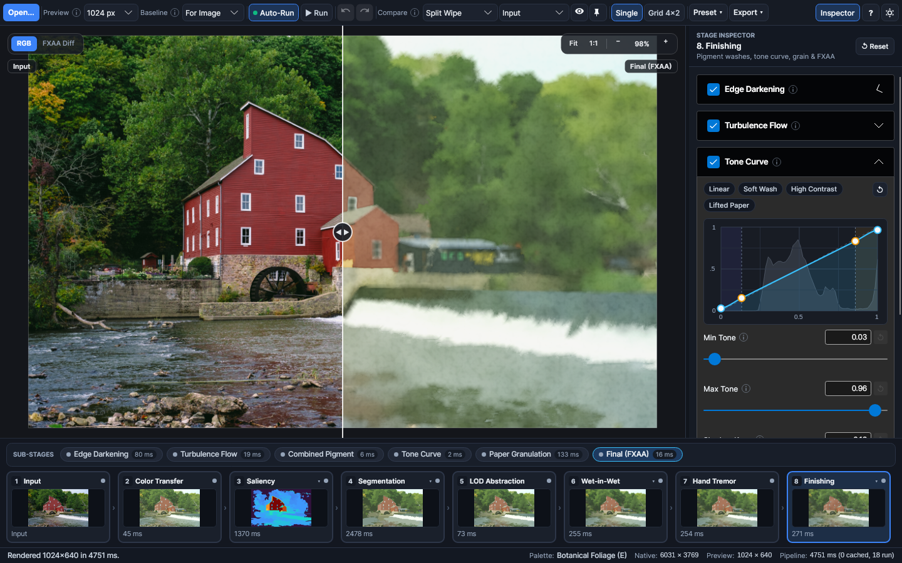

# Leiter Watercolor Studio

[](https://dotnet.microsoft.com/)
[](https://avaloniaui.net/)
[](LICENSE)

An interactive cross-platform desktop watercolor studio for [Leiter](https://github.com/mrazza/Leiter)'s multi-stage photo watercolorization pipeline, built with **.NET 10** and **Avalonia UI**.



---

## Features

- **8-Stage Pipeline Filmstrip & 20 Inspectable Views:** Scrub seamlessly through Input, Color Transfer, Saliency (5 sub-stages), Mean-Shift Segmentation (2 sub-stages), LOD Abstraction, Wet-in-Wet (3 sub-stages), Hand Tremor, and Finishing (6 sub-stages) with live per-stage timing badges and DAG staleness tracking.
- **Interactive Viewport & Synchronized 4×2 Grid View:** Pan and zoom from `10%` to `1600%` (with automatic `>= 800%` pixel grid), inspect per-pixel color and stage diagnostics on hover, or toggle a synchronized `4×2` Grid view across all 8 primary stages.
- **A/B Visual Comparison & Diagnostics:** Compare any active view against the **Input** photo, **Previous Stage**, or any **Pinned Stage** using **Split Wipe** or **Side by Side** mode, alongside rich diagnostic visualizations (segmentation region averages/randoms/boundaries, Turbo/Viridis saliency heatmaps, wet masks, pigment density maps, paper relief, and FXAA edge magnifier).
- **Full Parameter Control with Layman & Technical Guidance:** Edit Basic and Advanced parameters for all 7 configurable stages—including an interactive `ToneCurveEditor`, `PerlinNoiseEditor` cards, and `Auto` / `Built-In` / `Custom` CIELAB & reference-image palette extraction. Every setting title retains its technical tooltip while its adjacent `(i)` icon provides a layman explanation of intermediate and final visual impact.
- **Baseline Calibration, Drag-Coalesced Undo/Redo & Themes:** Switch baseline modes (`For Image`, `For Size`, `Default`), undo/redo smoothly across slider drags (`200`-step history), pause/resume Auto-Run, and switch between Dark and Light studio themes.
- **Presets & Full-Resolution Exports:** Save and load portable JSON presets (`preset.json`) with optional resolution-adaptive scaling, render full resolution on demand, export single final images (PNG, JPEG, WebP), or export all **24 diagnostic stage PNGs** plus a `preset.json` sidecar in one bundle.

---

## Installation & Getting Started

### Prebuilt Binaries (Linux, Windows, macOS)

Standalone executables for the latest release ([v0.1.0](https://github.com/mrazza/LeiterWatercolorStudio/releases/tag/v0.1.0)) are available for download:

- **Linux:** [x64 (tar.gz)](https://github.com/mrazza/LeiterWatercolorStudio/releases/download/v0.1.0/LeiterWatercolorStudio-linux-x64.tar.gz) • [ARM64 (tar.gz)](https://github.com/mrazza/LeiterWatercolorStudio/releases/download/v0.1.0/LeiterWatercolorStudio-linux-arm64.tar.gz)
- **Windows:** [x64 (zip)](https://github.com/mrazza/LeiterWatercolorStudio/releases/download/v0.1.0/LeiterWatercolorStudio-win-x64.zip) • [ARM64 (zip)](https://github.com/mrazza/LeiterWatercolorStudio/releases/download/v0.1.0/LeiterWatercolorStudio-win-arm64.zip)
- **macOS:** [Apple Silicon / ARM64 (tar.gz)](https://github.com/mrazza/LeiterWatercolorStudio/releases/download/v0.1.0/LeiterWatercolorStudio-osx-arm64.tar.gz) • [Intel / x64 (tar.gz)](https://github.com/mrazza/LeiterWatercolorStudio/releases/download/v0.1.0/LeiterWatercolorStudio-osx-x64.tar.gz)

Extract the archive and run `LeiterWatercolorStudio` (or `LeiterWatercolorStudio.exe` on Windows).

### Gentoo via Portage

Leiter Watercolor Studio is available in the [razza overlay](https://github.com/mrazza/razza-overlay) with ReadyToRun precompilation and Dynamic PGO optimization:

```bash
eselect repository add razza git https://github.com/mrazza/razza-overlay.git
emerge media-gfx/leiter-watercolor-studio
```

### Building from Source

#### Prerequisites

- [.NET 10 SDK](https://dotnet.microsoft.com/download/dotnet/10.0) (targets `net10.0`)

#### Clone & Run

Because `LeiterWatercolorStudio` includes [Leiter](https://github.com/mrazza/Leiter) as a git submodule at `extern/Leiter`, clone recursively:

```bash
git clone --recurse-submodules https://github.com/mrazza/LeiterWatercolorStudio.git
cd LeiterWatercolorStudio
```

If you already cloned without submodules, initialize them before building:

```bash
git submodule update --init --recursive
```

Run the desktop studio:

```bash
dotnet run --project src/LeiterWatercolorStudio.App -c Release
```

#### Build & Test

```bash
# Build the full solution
dotnet build LeiterWatercolorStudio.slnx -c Release

# Run the full Core + Headless Avalonia test suite
dotnet test LeiterWatercolorStudio.slnx -c Release
```

Cross-platform target builds (such as Windows `win-x64`, Linux `linux-x64`, or macOS `osx-arm64`) are also supported:

```bash
dotnet build src/LeiterWatercolorStudio.App/LeiterWatercolorStudio.App.csproj -c Release -r win-x64 --no-self-contained
```

---

## Pipeline Stages & Inspectable Views

| # | Primary Stage | Inspectable Stage Views (`StageViewId`) | Highlight Controls |
|---|---|---|---|
| **1** | **Input** | Input | Source metadata, resolution summary, baseline/palette overview |
| **2** | **Color Transfer** | Color Transfer | Palette Mode (`Auto` / `Built-In` / `Custom`), reference palette extraction, Transfer Strength, 6D CIELAB stats & illuminant |
| **3** | **Saliency** | EGBI Pre-Blur, EGBI Regions, RC Saliency Map, SaliencyCut Mask, Distance Field | Pre-Blur, EGBI, Regional Contrast, SaliencyCut trimap & GrabCut solver, Mask threshold & retention, Distance Field smoothing |
| **4** | **Segmentation** | Mean-Shift Filtered, Mean-Shift Regions | Spatial Radius, Range Radius, Min Region Size, convergence & connectivity |
| **5** | **LOD Abstraction** | LOD Abstraction | Salient & non-salient bilateral kernel sizing, distance scale/bias, cross-segment color scale |
| **6** | **Wet-in-Wet** | Wet-in-Wet Image, Wet Area Mask, Qualifying Boundaries | Filtering Mode, gradient/hue/intensity thresholds, scatter radius, seed probability, oriented elliptical feathering |
| **7** | **Hand Tremor** | Hand Tremor | Amplitude, salient scale, overlap darkening, Paper Gap Bias/Opacity, `#RRGGBB` / RGB Paper Color, Primary & Secondary `PerlinNoiseEditor` |
| **8** | **Finishing** | Edge Darkening, Turbulence Flow, Combined Pigment, Tone Curve, Paper Granulation, Final (FXAA) | Edge intensity/blur/operator, turbulence wash noise, interactive piecewise Tone Curve, granulation density/warp/grain noise, FXAA 3.11 |

---

## Keyboard Shortcuts

*(Single-key shortcuts are automatically disabled while editing numeric or text input fields.)*

| Shortcut | Action |
|---|---|
| `1` – `8` | Select primary pipeline stage (`Input` through `Finishing`) |
| `G` | Toggle between Single viewport and `4×2` Grid view |
| `Space` *(hold)* | Drag-to-pan viewport |
| `Ctrl+O` | Open source image *(or drag and drop onto window)* |
| `Ctrl+Shift+O` | Load preset JSON |
| `Ctrl+S` | Save preset JSON |
| `Ctrl+E` | Export final image (full resolution) |
| `Ctrl+Shift+E` | Export all 24 diagnostic stages + `preset.json` sidecar |
| `Ctrl+Z` | Undo last parameter edit |
| `Ctrl+Y` / `Ctrl+Shift+Z` | Redo parameter edit |
| `Ctrl+Enter` | Execute pipeline immediately |
| `Ctrl+0` | Fit to view / reset `4×2` grid zoom & pan |
| `Ctrl+1` | Reset zoom to `1:1` (`100%`) |
| `Ctrl++` / `Ctrl+-` | Zoom in / Zoom out |
| `Esc` | Cancel active render, or exit `4×2` Grid view |

---

## Solution Architecture

- **`src/LeiterWatercolorStudio.Core`**: UI-agnostic domain engine (`PipelineEngine`, `PipelineStageRegistry`, `PreviewScaling`, `PipelineStalenessTracker`, `StageVisualizers`, `PixelInspectorReadout`), observable stage ViewModels (`PipelineParametersViewModel`, `UndoRedoManager`), preset serialization (`PresetSerializer`), palette extraction (`PaletteExtractor`), and batch/final export (`ExportService`).
- **`src/LeiterWatercolorStudio.App`**: Avalonia UI desktop application (`MainWindow`, `ZoomPanViewport`, `PipelineFilmstrip`, `StageGridView`, `NumericSlider`, `PerlinNoiseEditor`, `ToneCurveEditor`, `SettingInfoIcon`, stage parameter inspectors, and Dark/Light themes).
- **`tests/LeiterWatercolorStudio.Core.Tests`**: xUnit suite covering pipeline DAG execution, staleness, visualizers, constraints, undo/redo, palette extraction, presets, exports, and real-image integration.
- **`tests/LeiterWatercolorStudio.App.Tests`**: Avalonia Headless xUnit suite covering UI integration, filmstrip/grid interactions, viewport zoom/pan, tone curve editing, tooltip/info-icon layout & theme coverage, and large-image caching.
- **`extern/Leiter`**: Git submodule containing the [Leiter](https://github.com/mrazza/Leiter) image processing and watercolorization library.

---

## License

`LeiterWatercolorStudio` is licensed under the **Apache License, Version 2.0** — see [LICENSE](LICENSE) for full terms.

The `extern/Leiter` submodule (`Leiter`) is a separate work licensed under the **GNU Lesser General Public License v3.0 (LGPL-3.0)** — see [extern/Leiter/LICENSE.md](extern/Leiter/LICENSE.md).
